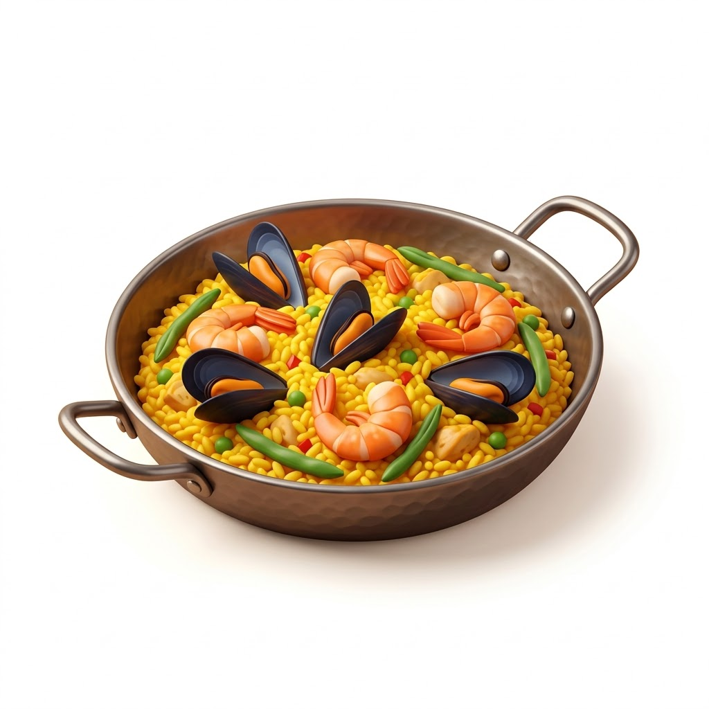
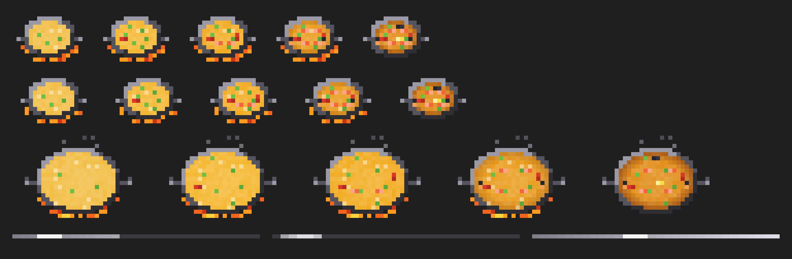

<div align="center">



<h1>cooked</h1>

<p><em>Stop babysitting Claude.</em></p>

<p>


</p>

<p>
<a href="#what-you-see">What you see</a> ·
<a href="#install">Install</a> ·
<a href="#how-the-bar-knows">How the bar knows</a> ·
<a href="#how-it-works">How it works</a> ·
<a href="#faq">FAQ</a>
</p>

</div>

---

> **Are you cooked staring at the screen, waiting for Claude to finish?**

You run three Claude Code terminals. One is refactoring, one is writing tests, one finished ten minutes ago and you didn't notice. `cooked` gives each terminal a name, a live progress bar and a paella that cooks while Claude works. One command shows every terminal at once.

v3 is a Claude Code **mod**: function hooks that draw straight into Claude Code's interface. No status-line script, no `/tmp` files, no settings patching.

---

## What you see

**Above the prompt, in every terminal** — its name, a progress bar, what it is doing right now, and a pixel-art paella with flames and steam:

```
[paella]  marshall  ━━━━━━━━━━━━━━━━━━━━╸─────────────────  3/7
          ▸ Writing the kitchen pane
          14 ops · 2 cooks · 1m 20s · editing register.tsx
          "upgrade cooked into a mod with a paella"
```

The paella sits on the left: a round pan seen from above, six rows tall, flames licking its lower edge and steam rising while Claude works. The rice goes from saffron to golden as the work advances. Peas go in first, then peppers, prawns and mussels; the socarrat darkens the edge; the lemon only when it's done.

**At the foot of the band, the session line** (in the theme's blue) with the session's figures:

```
opus 5.5 · context ███░░░░░░░ 34% · ↑1.2M ↓84k tokens · session 1h 05m · 5h limit 42%
```

Model, how full the context window is (a bar, with `near full` from 80%, when compaction is close), the tokens the session has spent (input with cache reads and writes, and output, every turn and subagent summed), how long the session has been open, and your usage limits (on a subscription) or the cost so far (with an API key).



**`/cooked` opens the kitchen** — a pane with every terminal on the machine running cooked:

```
Kitchen
3 terminals · 2 cooking

marshall  this terminal
━━━━━━━━━━━━━━━━━━━━━━━━━━━━━━╸─────────────────────  3/7 · 14 ops · 1m 20s
▸ Writing the kitchen pane

api  shop-backend
━━━━━━━━━━━━━━━━━━━━━━━━━━━━━━━━━━━━━━━━━━━━━━━━━━━━  cooked in 4m 02s · 61 ops

tests  shop-frontend
━━━━━━━━━━━━━━━━━━━━━━━━━━━━━━━━━━━━━━━━━━━━━━━━━━━━  9 ops · 0m 41s
▸ $ npm test
```

`/cooked name api` renames the terminal you're in. The default name is the project folder.

**When a turn finishes** — the same notification as v2, now naming the terminal: a banner under 2 minutes, a sticky alert you have to click past over 2 minutes, with what was asked, the folders touched and the tool mix. ✅ or ❌ says whether any tool failed.

---

## Install

From a Claude Code prompt:

```
/plugin install cooked --marketplace Marcelfedz/cooked
```

Or from a shell:

```bash
claude plugin marketplace add Marcelfedz/cooked
claude plugin install cooked@cooked
```

Coming from v2? Run the installer once; it updates the plugin and removes the v2 status-line script from `~/.claude/settings.json` (backup first, at `~/.claude/settings.json.before-cooked`):

```bash
curl -fsSL https://raw.githubusercontent.com/Marcelfedz/cooked/main/install.sh | bash
```

Needs a Claude Code build with function-hook mods. Built and tested on 2.1.302.

---

## How the bar knows

Claude Code has no idea how long a task will take, so a percentage based on time would be invented. `cooked` doesn't invent one.

- **When Claude keeps a task list** (`TodoWrite`, or `TaskCreate` / `TaskUpdate`), the bar is the real share of steps completed, `3/7`, and the line under it is the step in progress.
- **When it keeps none**, the band says `no task list` and the bar is a pulse sweeping the track: alive, but claiming nothing. The line under it says what the last tool call did (`$ npm test`, `editing register.tsx`, `briefing a cook: Explore the repo`).

Most quick turns don't make a list, and some Claude Code setups don't offer those tools to the model at all, so the pulse is the common case. `cooked` never asks Claude to make a list: it adds no tool and no text to the prompt, so it costs **zero extra tokens**. It only reads what Claude does anyway.

The paella is decoration and is allowed to guess: without a plan it browns slowly with time, and it never finishes before the turn does.

---

## How it works

One hooks module, `cooked/hooks/register.tsx`, on the mod API:

| Event | What cooked does |
|---|---|
| `turn.start` | A new dish: the prompt, the start time, counters reset. A subagent's turn counts as a cook. |
| `tool.call` | Counts the op, names the activity, tracks edited files; after `TodoWrite` / `TaskCreate` / `TaskUpdate`, updates the plan. Never blocks a call. |
| `turn.complete` | Marks it cooked, adds the turn's tokens to the session's tally and sends the notification. |
| `ui.render` `AbovePrompt` | Draws the band. The paella and the bars are `Raster` cells (half-block pixel art), animated with `$.ui.blit`. |
| `ui.render` `Pane` | Draws the kitchen. |
| `command.run` `cooked` | Opens or closes the kitchen; `name` renames the terminal. |
| Session line | The last row of the band, in the theme's blue, from `$.session.usage()` (context, limits, cost, session start) and the token tally. Once a second while cooking, every 15 s otherwise. |

State lives in `$.state`, so a reload of the mod keeps it. For the kitchen, each session writes one small JSON file to `~/.claude/cooked/kitchen/<session-id>.json` (a heartbeat every 15 s, removed at session end, files older than 12 h pruned); the pane reads the folder once a second. Nothing leaves the machine.

`node tools/paella-preview.ts` renders the pixel art to a PNG, for tweaking the recipe.

---

## FAQ

**Q: Is this safe?**
Yes. Every line is in this repo. It counts tool calls, times turns, writes one JSON file per open session under `~/.claude/cooked/`, and shows macOS or Linux notifications. It never sends data anywhere.

**Q: Will it slow Claude down?**
No. A tool call costs a couple of in-memory state writes. The animation repaints a few dozen cells at about seven frames a second, only while something cooks or the kitchen is open.

**Q: Can I turn off the band?**
`ctrl+x ctrl+a` (or the `[-]` beside it) collapses it, as with any band above the prompt.

**Q: Does it work outside the terminal?**
The desktop app draws the same band and kitchen with text bars (it has no pixel cells, so no paella). Notifications are macOS-first, `notify-send` on Linux, Claude Code's own channel elsewhere.

**Q: Why "cooked"?**
When Claude finishes a task, it's *cooked*. When you've been staring at a long-running terminal, *you're* cooked. The paella covers both.

---

## Configuration

| Env var | Default | What it does |
|---|---|---|
| `COOKED_ALERT_THRESHOLD` (or `PAELLA_ALERT_THRESHOLD`) | `120` | Seconds. Turns longer than this get a sticky alert instead of a banner. |
| `COOKED_NOTIFY` | on | `off` silences the finish notifications; the band and kitchen stay. |
| `COOKED_REPO` | `Marcelfedz/cooked` | The repo `install.sh` pulls from (for forks). |

**Branded banner icon (optional, macOS).** With [terminal-notifier](https://github.com/julienXX/terminal-notifier) installed (`brew install terminal-notifier`), banners carry the paella icon instead of Script Editor's.

---

## Platform support

| | Band + kitchen | Quick banner | Sticky alert |
|---|---|---|---|
| macOS | ✅ | ✅ | ✅ |
| Linux | ✅ | ✅ via `notify-send` | ⚠️ urgent persistent (closest available) |
| Windows | ✅ | via Claude Code's notification channel | ❌ |

---

## Uninstall

```bash
claude plugin uninstall cooked
claude plugin marketplace remove cooked
rm -rf ~/.claude/cooked
```

If you installed with `install.sh`, `bash ~/.claude/plugins/marketplaces/cooked/uninstall.sh` does all of it and restores the settings backup.

---

## License

MIT. Use it, fork it, ship it. See [`LICENSE`](./LICENSE).

---

<div align="center">
<sub><em>"Caveman saves your tokens. cooked saves your attention."</em></sub>
</div>
